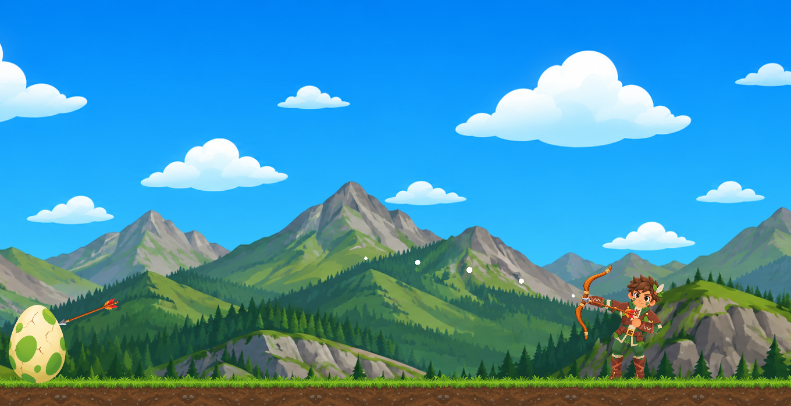
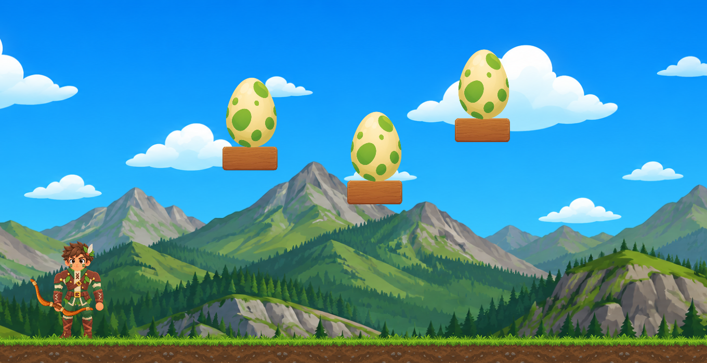

  

# Target Quest 🎯🏹

**Target Quest** is a 2D physics-based arcade archery puzzle game developed in **Godot Engine**[cite: 10]. It blends precise tactical angle calculation, smooth projectile mechanics, and infinite procedural puzzle generation[cite: 10].

---

## 📸 Gameplay Screenshots

| Core Gameplay & Bow Mechanics | Procedural Multi-Platform Puzzle |
| :---: | :---: |
|  |  |

---

## ✨ Key Features

* **Infinite Procedural Level Generation:** Hand-crafted introductory stages (1–4) followed by a smart seed-based level generator from Level 5 onward to ensure infinite unique layouts.
* **Overlap-Free Spatial Grid:** Utilizes a strict minimum safe-distance algorithm to guarantee bases and targets never overlap or collapse into each other.
* **Moving Platform Dynamics:** Dynamic difficulty scaling featuring smooth, jerk-free sine-wave moving wooden bases starting from Level 10.
* **Precise Arrow Embedding & Z-Indexing:** Real-time arrow embedding into targets, wooden platforms, and ground terrain with preserved global transforms and depth stacking (`z_index = -1`).
* **Immersive Audio Feedback:** Integrated audio cues for bow string shooting, egg impacts, wooden platform collisions, and grass hits.

---

## 🛠️ Built With

* **Engine:** Godot Engine (GDScript)
* **Art Assets:** Stylized 2D Vector Graphics & UI Kits

---

## 📜 Licensing & Usage

* **Source Code:** Distributed under the **MIT License**. Free to inspect, fork, and adapt.
* **Art & Audio Assets:** Located within the `Free_Asset_Pack` folder and licensed strictly for **Educational & Non-Commercial Use** (see [ASSETS_LICENSE.md](ASSETS_LICENSE.md) for full terms).

---

## 👨‍💻 Developed By
Created by **KernelVoltage**.
